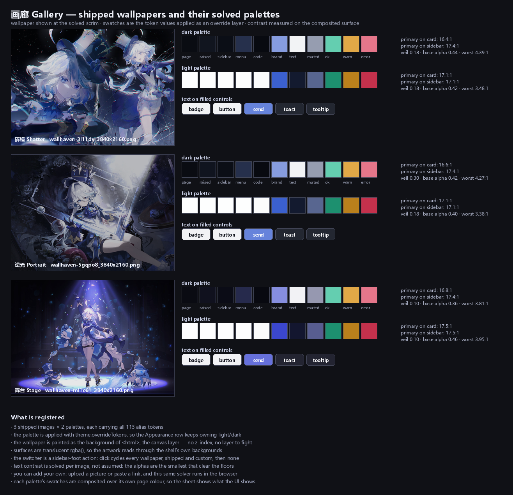

# 画廊 Gallery — DSH 壁纸主题插件

给 DeepSeek Harness Web 界面换壁纸，并为**每一张图片单独求解一整套配色**。
内置三张壁纸，也可以上传自己的图片或粘贴图片链接 —— 配色从像素本身算出来，
不是挑出来的。



---

## 特性

| | |
|---|---|
| **壁纸** | 3 张内置图，外加任意你添加的图；每张都带浅色与深色两套完整配色（**113 个 alias token**） |
| **添加壁纸** | 上传文件、拖入页面、或粘贴图片链接；配色在浏览器里从图片像素实时求解 |
| **配色如何生效** | `theme.overrideTokens()` —— 叠加一层 token，所以「外观」里的浅色/深色/跟随系统仍然由系统控制 |
| **背景** | 画在 `<html>` 上，作为画布层 |
| **切换入口** | 只在**设置**里；侧边栏不再注册任何切换按钮 |
| **设置页** | 「壁纸」页：带预览的选择器、添加流程、压暗滑块、模糊滑块、**四个页面的独立不透明度滑块**、删除 |
| **持久化** | 选中项、压暗、模糊、各页面不透明度都是 Host `Config` 字段，写在 `$DSH_PROFILE_DIR/cordis.patch.yml`；壁纸库在 `$DSH_HOME/theme-gallery/v1/` |
| **预绘制** | Host 注入一段 head 脚本和样式表，保存的壁纸在首次绘制前就已就位，不会闪一下 |

内置三张图：

| Slug | 标题 | 源图 | 主色相 | 暗部占比 | 中位色 | 高光 |
|---|---|---|---|---|---|---|
| `shatter` | 碎镜 Shatter | `sources/shatter.png` | 225° | 30% | `#323f6c` | `#f0f5fc` |
| `portrait` | 逆光 Portrait | `sources/portrait.png` | 225° | 57% | `#212334` | `#fafcff` |
| `stage` | 舞台 Stage | `sources/stage.png` | 235° | 58% | `#161526` | `#bac2ff` |

---

## 安装

这是一个 DSH **profile 插件包**（bundle）。它通过 `package.json` 里的
`dsh.bundle.patch` 自行挂载，不需要手工编辑 profile 的 `cordis.patch.yml`。

### 方式一：从 GitHub URL 安装（推荐）

在 DSH 里让 agent 执行：

```
plugin_manager install_bundle
  target: https://github.com/guiyuanyuanbao/dsh_theme_gallery.git
```

或使用命令行：

```bash
dsh plugin --profile <profile> install https://github.com/guiyuanyuanbao/dsh_theme_gallery.git
```

### 方式二：本地克隆后 link

```bash
git clone https://github.com/guiyuanyuanbao/dsh_theme_gallery.git
```

然后让 agent 用 `plugin_manager` 的 `install_bundle`，`target` 指向你克隆出来的
**绝对路径**。

### 方式三：手工加入 profile

在 `$DSH_PROFILE_DIR/package.json` 的 `dependencies` 里加一行，再装一次：

```json
{
  "dependencies": {
    "dsh-theme-gallery": "github:guiyuanyuanbao/dsh_theme_gallery"
  }
}
```

### 装完之后

**Host 那一半需要重启 DSH 才生效。** HMR 刻意忽略 `node_modules`，所以
`index.js` / `api.js` / `store.js` 的改动不会热更新。纯前端的改动刷新页面即可。

### 版本要求

| 要求 | 范围 |
|---|---|
| `engines.dsh` | `>=0.2.0-rc.2 <0.3.0-0` |
| `@deepseek-ai/dsh-home-paths` | `>=0.2.0-rc.2 <0.3.0-0` |
| `@deepseek-ai/schemastery` | `~3.18.4` |

写成开区间而不是钉死某个版本，是有原因的：早期版本钉了 `0.2.0-rc.2`，
结果同一个 minor 的后续构建全部被判定不兼容，装上就报「可能导致崩溃或数据丢失」。
兼容性规则是「有 `engines.dsh` 就只看它，否则逐个检查 peer 范围」，而
`semver.satisfies(runtime, range, { includePrerelease: true })` 对精确的预发布
版本号会拒绝同 minor 的所有后续构建。

> 从 **git 或 tarball** 安装时，安装器无法在下载前预检版本，只能装完再校验。
> 所以如果你的 DSH 版本不满足上表，会在安装后报 `incompatible-version`。

---

## 使用

- **切换壁纸** —— 打开 设置 → 壁纸，点一张卡片。卡片显示的就是那张壁纸本身，
  点下去立刻应用它的配色。
- **调整观感** —— 同一页有压暗程度、背景模糊，以及每个页面的不透明度。
- **让某个页面更好读** —— 把它的不透明度滑块往右拉。`0%` 完全透明、`100%` 完全不透明，
  所以「太透」就往**上**调。设置面板是最常需要调的那个；**输入框**则是打字时最需要的
  那个 —— 它调的是那个圆角框本身，不会动到周围的页面。
- **恢复求解值** —— 点「恢复求解值」，把当前壁纸的不透明度退回配色求解时实测的值。
- **添加壁纸** —— 选文件、拖入、或粘贴链接后点「从链接添加」。分析通常一两秒。
  新壁纸保存后会自动选中。

每个壁纸的设置**按主题分别记忆**。没调整过的壁纸停在它自己的求解值上
（碎镜的设置面板 61%、逆光的 59%、碎镜的输入框 67%）。

### 四个不透明度滑块

| 滑块 | 作用元素 | 重述的 token |
|---|---|---|
| 设置面板 | `[role="dialog"]` | `--dsw-alias-bg-layer-2` |
| 侧边栏 | `[class*=sidebarCol]` | `--dsw-specific-sidebar-fill` |
| 聊天页面 | `[class*=frame]` | `--dsw-alias-bg-base` |
| 输入框 | 输入框座位下的 `[class*=card]` | `--dsw-specific-input-major` |

四个页面用的是**不同的**全局 token，所以只能分别调；改一个共享 token 会把四个一起压平。
输入框之所以能独立调节，是因为 DSH 本来就用 `--dsw-specific-input-major` 画它，
而求解给这个 token 的透明度（0.59–0.69）与聊天页面的 `bg-base`（0.44）不同 ——
两者本来就是两种颜色。

---

## 它是怎么工作的

### 配色是求解出来的，不是挑出来的

每张图先被分析出主色相、明暗分布、中位色与高光，然后对 **113 个 token** 逐个求解
透明度：在给定的对比度下限下，求出最透的那个值。这样壁纸能透出来，文字又还看得清。

求解结果在 `tools/palette.json` 里，生成的 token 表在 `theme-data.js`（内置图）和
浏览器端（自定义图）里。

### 壁纸跟随明暗模式，而不是决定它

配色按浅色/深色各解一套。系统切到深色，壁纸跟着换到深色那套 ——
插件的 token 层始终覆盖在当前主题之上，不接管「外观」那一行的所有权。

### 浏览器求解，Host 落盘

```
   ┌─ 浏览器 ───────────────────────┐        ┌─ Host ──────────────────────┐
   │ canvas 解码图片                 │        │                             │
   │ 重采样到 2560px                 │        │                             │
   │ 分析像素 ─► 求解配色            │  POST  │ 校验、写入图片与配色、        │
   │ 重新编码为 JPEG                 │ ─────► │ 更新 index.json              │
   └────────────────────────────────┘        └─────────────────────────────┘
```

**为什么配色在浏览器里算**：Host 是 Node，没有图片解码器 —— 没有 JPEG、没有 PNG，
加一个就意味着 profile bundle 里多一个原生依赖。浏览器有 `createImageBitmap` 和
`getImageData`，能解用户手上几乎所有格式，而且它正是要绘制这张图的那个解码器，
所以配色就是从用户最终看到的那些像素推出来的。

**为什么抓取 URL 在 Host 做**：浏览器的跨域限制会让大部分图片链接直接失败，
而 Host 没有这个限制。抓取有大小上限、内容类型嗅探和超时。

### 不透明度是绝对的

`0%` 完全透明，`100%` 完全不透明，在任何主题、任何页面上含义都一样。

早期版本把值表达为「求解值的百分比」，于是 `100%` 意思是「求解出来的半透明度」。
这对这个控件想解决的问题正好反了：求解出的透明度往往**太透**，用户真正需要的值在它
**上面**，而一个顶部写着「不变」的刻度，两端都到不了那个值。

实现上还有一个必须做对的地方：

```css
background-color: color-mix(in srgb,
  rgb(from var(--dsw-alias-bg-layer-2) r g b / 1) var(--dsh-gallery-opacity-panel, 100%),
  transparent);
```

- **先强制颜色不透明，再混合。** `color-mix` 对 `transparent` 是**缩放** alpha
  （产出 `alpha × P/100`），所以直接混合 token 只能让它更透明，永远到不了需要的不透明度。
- **`rgb(from C r g b / 1)` 丢掉 token 自己的 alpha**，只取颜色通道，于是混合结果是
  `1 × P/100` —— 正好是请求的值。token 仍然提供颜色，但不再决定透明度。
- 不支持相对颜色语法或 `color-mix` 的浏览器会丢弃整条声明，回落到求解值 ——
  也就是这个功能出现之前的样子，而不是坏掉的样子。

### 输入框的遮罩

DSH 用一条渐变压住滚到输入框底下的正文：

```css
.Root[data-phase=active] .composerSeat {
  background: linear-gradient(180deg,
    color-mix(in srgb, var(--dsw-alias-bg-base) 0%, transparent) 0px,
    var(--dsw-alias-bg-base) 36px);
}
```

token 不透明时这条渐变**看不见**（等于把颜色混进它自己）；壁纸让它变半透明后，
起点那个 `transparent` 就成了一个真的洞 —— 输入框前 36px 完全没有遮罩，正文
滑过去仍然清晰可读，整块比上方对话面**浅一层**。

插件把这条渐变改写成同一颜色的**平铺填充**，用的是同一个 `opacityFill()`，
所以两者不可能算出两个不同的 alpha。有三点是必需的：

- **`background-image: none` 不能省。** DSH 用 `background` 简写画渐变，
  简写会把 `background-color` 重置为透明；只给颜色不改简写，等于什么都没做。
- **选择器必须比 DSH 自己的更长。** DSH 那条是 `.Root[data-phase=active] .Seat`，
  即特异性 `(0,3,0)`。把 scrim 拼在所属面选择器后面得到 `(0,4,0)` 才稳赢；
  只锚到 gate 上会打平，结果取决于样式表顺序。
- **`data-composer-seat` 和 `data-conversation-region="composer"` 在同一个元素上**，
  必须并排写。写成祖先后代关系读起来完全正确，但匹配**零个**元素 —— 滑块会
  静默失效，没有任何报错。

这条遮罩属于**聊天页面**而不是输入框：它的职责是把正文淡入页面，必须和页面同色同 alpha。
输入框是画在它上面的另一层、更实的东西。

### 侧边栏列表底部那条渐变没有动

`[class*=fade]`（`linear-gradient(transparent, var(--dsw-specific-sidebar-fill))`）
形状和成因一样，但用途不同：它是列表到底了的装饰性软边，不是遮住用户不该看的内容，
洞也只有 24px。按同样方式压平会在那里**再叠一层**侧边栏自己的颜色，结果是一条明显的
深色横条，而不是消除一条。所以保留原样，并记录在这里。

---

## 项目结构

```
dsh_theme_gallery/
├── package.json          dsh.bundle.patch / dsh.client / files / engines / peerDependencies
├── cordis.patch.yml      这个 bundle 挂载的那一行
├── index.js              Host：Config、路由、预绘制注入
├── api.js                Host：自定义主题 API 与校验
├── store.js              Host：磁盘上的壁纸库、URL 抓取
├── theme-data.js         内置三张图生成的配色表
├── client.js             浏览器端：求解器、画布、设置页（**生成文件，不要手改**）
├── assets/               三张壁纸，2560px JPEG q82（随包安装）
├── sources/              三张原始 PNG（随仓库分发，**不**随包安装）
├── preview.png           上面那张总览图
├── tools/                构建与验证工具（不随包安装）
│   ├── build_palettes.py     图像分析、alpha 求解、配色与客户端生成
│   ├── solver.js             配色求解器，浏览器与一致性测试共用
│   ├── client.template.js    客户端模板，含 @PALETTES@ / @SOLVER@ 拼接点
│   ├── extract_roles.py      从 DSH 样式表提取 token 极性 → roles.json
│   ├── build_preview.py      生成 preview.png
│   ├── dsh_paths.py          定位本机 DSH 安装（可用 DSH_ROOT 覆盖）
│   ├── peer-resolver.mjs     为验证脚本解析 DSH 的 peer 依赖
│   ├── verify.py             对生成的 bundle 做独立验证
│   ├── verify-solver.mjs     证明 JS 求解器与 Python 生成器逐字节一致
│   ├── verify-inlined.mjs    从 client.js 里抽出求解器再复现同一批 token
│   ├── verify-end-to-end.mjs 真实图片 → 求解 → 真实 API → 重启后逐 token 还原
│   ├── verify-behaviour.mjs  用桩服务驱动 apply()
│   ├── verify-store.mjs      真实文件系统上的壁纸库与 URL 守卫
│   ├── verify-api.mjs        真实 HTTP 上的自定义主题 API
│   ├── verify-compat.py      清单里的版本范围
│   ├── verify-scrim-defects.py 反向注入缺陷，证明检查会失败
│   ├── tokens.json           113 个 alias token，从 DSH 主题样式表提取
│   ├── roles.json            每个 token 在两种模式下的极性（基准真值）
│   └── palette.json          完整记录：分析值、求解参数、每张图的浅色/深色配色
├── .github/workflows/verify.yml
├── LICENSE               MIT
└── README.md
```

**`files` 字段是有意的**：`assets/` 随包安装，`sources/`、`tools/` 不随包安装。
pnpm 安装 git 依赖时会遵守这个字段，所以别人安装时不会下载那 35MB 原始图。

---

## 构建与验证

需要 Python 3.10+（`numpy`、`pillow`）与 Node 18+。

```bash
# 从原始图重建配色与 client.js
python tools/build_palettes.py

# 重新生成总览图
python tools/build_preview.py

# 全套验证
python tools/verify.py
python tools/verify-compat.py
python tools/verify-scrim-defects.py
node tools/verify-solver.mjs
node tools/verify-inlined.mjs
node tools/_runstore.mjs
node tools/_runapi.mjs
node tools/_rune2e.mjs
node tools/verify-behaviour.mjs client.js
node --check client.js
```

部分检查要读 DSH 自己的文件（主题样式表、peer 依赖）。它们会自动探测本机安装；
找不到时**跳过并说明**，而不是失败 —— 这样在 CI 上也能跑。要指定安装位置：

```bash
DSH_ROOT=/path/to/node_modules/@deepseek-ai/dsh python tools/verify.py
```

### 为什么 `client.js` 不能手改

它由 `tools/client.template.js` 加上配色表和求解器拼接而成。手改会在下次构建时
被覆盖，而 `verify.py` 会检查拼接结果与 `solver.js` 是否逐字一致 —— 所以手改
过不了验证。

### 为什么求解器是第三个模块

浏览器需要它，一致性测试也需要它，但两者需要不同形态：`client.js` 从一个路由原样
发出，无法解析 `import`；测试在 Node 下正常导入。所以构建时把它拼进去，
**唯一的变换是去掉 `export` 语句**，这样两份文本可以逐字 diff。`verify.py` 断言
内联版本与 `solver.js` 一致，所以手改其中一份无法悄悄偏离。

### 为什么壁纸用路由提供而不是内联

把 base64 塞进 `client.js` 可行，但每 1 字节 JPEG 要花 1.33 字节体积，每次 bundle
变更都要重传，还让本该用来看插件做什么的文件里多出一兆 base64。三张图放在一个路由后面，
bundle 保持在 170KB 左右，浏览器还能把图片永久缓存。

---

## 验证情况

已确认的结论（含真实浏览器实测）：

| 项目 | 结果 |
|---|---|
| **配色对比度** | 三张图 × 两种模式，最差对比度 3.38–4.39，全部达标 |
| **求解器一致性** | JS 求解器与 Python 生成器逐字节一致：72 个分析值、1356 个 token、42 个参数 |
| **生成文件自洽** | `verify-inlined.mjs` 从 `client.js` 里抽出求解器并复现全部 **678 个 token** |
| **端到端** | 真实图片 → 求解 → 真实 HTTP API → 重启后逐 token 还原（226 个 token 不变） |
| **不透明度是绝对的** | 真实 Chrome：100% 得到 alpha `1.0`，0% 得到 `0`，61% 得到 `0.61` |
| **四个页面互相独立** | 输入框 10% + 聊天页面 90% 时，输入框 `0.1`、对话面 `0.9` |
| **按主题记忆** | 碎镜面板设 100%，切到逆光显示它自己的 59%，拖到 24%，切回碎镜仍是 100% |
| **输入框遮罩** | 座位渐变被清除（`backgroundImage: none`，说明插件规则**赢了层叠**），座位与上方对话面计算色完全相同 |
| **反向注入** | 27 个缺陷逐一注入，`verify.py` 每次都失败 |

### 没有验证的部分

诚实记录，避免过度声称：

- **自定义壁纸添加流程的视觉结果**没有在浏览器里看过 —— 它靠 slot 台账、
  `verify-behaviour.mjs` 驱动真实组件、以及 `verify-end-to-end.mjs` 来证明。
- **`rgb(from …)` 承担着关键职责且较新**（Chrome 119+）。不支持时整条声明被丢弃，
  所有页面回落到求解值 —— 控件看起来「没反应」，但没有报错。测试测的是计算后的
  alpha 而不是声明本身，所以回归会在测试里暴露。
- **三个选择器依赖构建期哈希类名**：`[class*=sidebarCol]`、`[class*=frame]`、
  `[class*=card]`。DSH 重新构建可能改名，那时对应滑块会静默失效。这是真实的脆弱点，
  之所以接受，是因为这三个元素没有语义钩子。症状有限且可见（一个滑块不起作用），
  且用的是子串匹配，哈希前缀变了仍能命中。
- **把两个属性写成祖先后代关系这种错误，静态检查抓不到**。匹配零个元素的选择器，
  和一个只是暂时没用的选择器，在文本上无法区分。它是靠在真实浏览器里数命中数量发现的。

---

## 素材来源

三张壁纸来自 [Wallhaven](https://wallhaven.cc)，原始文件保留在 `sources/` 里以便重建配色。
如果你要再分发这些图片，请自行确认它们各自的授权条款。

代码以 MIT 许可发布，见 [LICENSE](LICENSE)。
